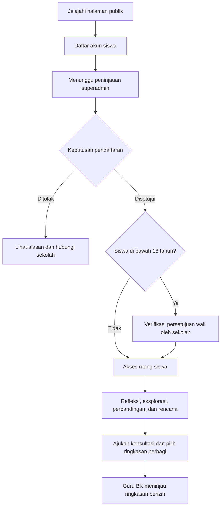
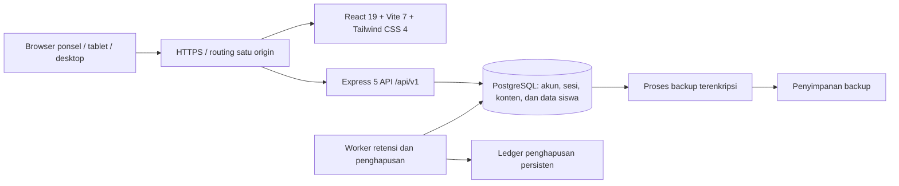

<p align="center">
  
</p>

<h1 align="center">LANGKAHKU</h1>

<p align="center">
  <strong>Langkah kecil, arah yang lebih jelas.</strong><br />
  Portal perencanaan karier siswa SMA kelas XI dan XII untuk mengenali diri,
  menjelajahi pilihan, menyusun rencana, dan terhubung dengan guru BK sekolah.
</p>

<p align="center">
  <a href="https://langkahku-kohl.vercel.app">Aplikasi Web</a> ·
  <a href="./deploy/README.md">Panduan Deployment</a> ·
  <a href="./docs/vercel-deploy.md">Deployment Vercel</a> ·
  <a href="./docs/operations.md">Panduan Operasi</a>
</p>

<p align="center">
  
  
  
  
  
  
  <a href="https://github.com/tegokkk/LANGKAHKU/actions/workflows/quality.yml"></a>
</p>

---

## Daftar Isi

1. [Ringkasan Proyek](#ringkasan-proyek)
2. [Fitur Unggulan](#fitur-unggulan)
3. [Arsitektur & Diagram Alur](#arsitektur--diagram-alur)
4. [Struktur Repositori](#struktur-repositori)
5. [Halaman & Hak Akses](#halaman--hak-akses)
6. [Panduan Instalasi & Menjalankan Lokal](#panduan-instalasi--menjalankan-lokal)
7. [Variabel Lingkungan](#variabel-lingkungan)
8. [Panduan Deployment](#panduan-deployment)
9. [Keamanan & Privasi](#keamanan--privasi)
10. [Daftar Perintah](#daftar-perintah)
11. [Pengujian & Pemantauan](#pengujian--pemantauan)
12. [Pembaruan & Dokumentasi](#pembaruan--dokumentasi)

---

## Ringkasan Proyek

**LANGKAHKU** membantu siswa menyusun arah setelah SMA melalui refleksi mandiri, eksplorasi informasi, perbandingan pilihan, dan rencana langkah per semester. Empat jalur utama—**Kuliah**, **Kerja**, **Kuliah + Kerja**, dan **Usaha**—disajikan setara dengan pendampingan sekolah.

Antarmuka memakai warna maroon `#6E2035`, latar ivory, aksen pastel, tipografi **Plus Jakarta Sans**, dan kartu membulat. Layout menyesuaikan ponsel, tablet, dan desktop, dengan navigasi bawah, form, tab, serta panel untuk layar kecil.

Sistem menghubungkan tiga peran: **siswa**, **guru BK**, dan **superadmin**. Data disimpan di PostgreSQL melalui Express API, dengan sesi login di server. LANGKAHKU merupakan alat refleksi dan pendampingan; aplikasi tidak memberikan skor psikologis, menentukan jurusan, atau mengambil keputusan karier secara otomatis.

---

## Fitur Unggulan

### 1. Ruang Siswa

- **Beranda Langkahku**: melihat progres dan melanjutkan langkah refleksi, eksplorasi, perbandingan, serta rencana.
- **Kenali Diriku**: refleksi bertahap tentang minat, pelajaran, kekuatan, nilai kerja, dan dukungan, tanpa skor atau pelabelan siswa.
- **Peta Jalur & Profesi**: pencarian dan filter berdasarkan kategori jalur, jenis materi, serta kelompok eksplorasi RIASEC.
- **Timbang Pilihan**: membandingkan pilihan berdasarkan minat, kemampuan, biaya, dukungan, dan peluang.
- **Rencana Langkahku**: menyusun tujuan utama, alternatif, dan checklist kegiatan per semester; mendukung tampilan cetak.
- **Jurnal Privat**: mencatat refleksi harian yang hanya dapat dibaca siswa pemilik.
- **Sapa Guru BK**: mengajukan konsultasi, memantau status permintaan, dan memilih ringkasan yang ingin dibagikan.
- **Kendali Data**: mengekspor data sendiri, mencabut ringkasan berbagi, dan meminta penghapusan data atau akun.

### 2. Ruang Guru BK

- **Antrean Konsultasi**: meninjau permintaan siswa dan mengelola jadwal serta status pendampingan.
- **Ringkasan Berizin**: membaca snapshot refleksi, perbandingan, atau rencana yang dipilih siswa; jurnal tetap privat.
- **Agregat Kebutuhan**: melihat ringkasan kelompok dengan pembatasan tampilan untuk kelompok kecil.
- **Kelola Konten**: menyusun jalur, profesi, cerita, dan lembar kerja melalui status draft, review, published, dan archived.
- **Layanan Sekolah**: mengisi jam layanan, estimasi respons, kontak bantuan, dan penanggung jawab.

### 3. Administrasi Superadmin

- **Persetujuan Pendaftaran**: meninjau siswa yang menunggu keputusan, menyetujui atau menolak dengan alasan.
- **Verifikasi Wali**: mencatat persetujuan wali secara terpisah dari persetujuan akun siswa di bawah 18 tahun.
- **Akun Guru BK**: membuat dan mengelola akun staf yang terikat sekolah.
- **Angkatan & Retensi**: mengatur angkatan, tanggal penghapusan, dan memantau pekerjaan penghapusan data.
- **Pembatasan Peran**: administrasi akun tidak memberi akses otomatis ke jurnal atau data konseling siswa.

### 4. Akses Publik, Mobile & Luring

- Halaman tentang aplikasi, panduan penggunaan, cerita, panduan orang tua, FAQ, dan kebijakan privasi.
- Katalog publik dapat dibaca tanpa login; materi tertentu dapat disimpan secara eksplisit untuk akses luring.
- Lembar kerja kosong tersedia untuk unduh PDF dan cetak A4.
- Navigasi mobile, tombol sentuh, tab yang dapat digeser, dan panel yang menyesuaikan layar.
- Service worker menyimpan shell publik serta aset build; API, sesi, dan data privat tidak dicache.

---

## Arsitektur & Diagram Alur

### Alur Akses Siswa



### Arsitektur Sistem



Frontend dan API memakai satu origin agar alur cookie sesi konsisten. Express dapat berjalan sebagai proses server persisten atau melalui adapter `api/index.mjs` di Vercel. Worker, ledger, dan backup dioperasikan tersendiri sesuai lingkungan deployment.

---

## Struktur Repositori

```text
LANGKAHKU/
├── api/
│   └── index.mjs                # Adapter Express untuk Vercel Functions
├── backend/
│   ├── migrations/             # Migrasi SQL PostgreSQL
│   ├── scripts/                # Setup, migrasi, worker, backup, dan restore
│   ├── src/
│   │   ├── config/             # Environment, database, dan logger
│   │   ├── middleware/         # Sesi, peran, dan pembatasan akses
│   │   ├── modules/            # Auth, siswa, konten, konsultasi, approval, hak data
│   │   ├── jobs/               # Retensi dan penghapusan data
│   │   ├── utils/              # Password, readiness, backup, dan runtime
│   │   ├── app.js              # Aplikasi Express dan middleware HTTP
│   │   └── server.js           # Server persisten dan graceful shutdown
│   └── tests/                  # Pengujian integrasi dan fixture khusus test
├── frontend/
│   ├── public/                 # Ikon, manifest PWA, worker, dan lembar kerja
│   ├── scripts/                # Generator service worker dari hasil build
│   └── src/
│       ├── components/         # Komponen UI dan panel
│       ├── context/            # State autentikasi
│       ├── features/           # Login dan dokumen siswa
│       ├── hooks/              # Resource API dan status koneksi
│       ├── layouts/            # Navigasi publik, siswa, dan staf
│       ├── pages/              # Halaman aplikasi
│       ├── services/           # Klien API dan cache materi publik
│       ├── styles/             # Token desain dan layout responsif
│       └── tests/              # Pengujian frontend
├── deploy/                     # Caddy, konfigurasi database, dan panduan deploy
├── docs/                       # Operasi, audit, verifikasi, dan panduan Vercel
├── design/                     # Referensi visual dan bukti pemeriksaan UI
├── .github/workflows/          # Quality gates backend dan frontend
├── compose.production.yml      # Database, migrator, API, worker, backup, dan proxy
├── Dockerfile                  # Build frontend dan image runtime
├── vercel.json                 # Build dan routing full-stack Vercel
├── PRD.md                      # Kebutuhan produk
└── README.md
```

---

## Halaman & Hak Akses

| Area | Rute utama | Akses |
| --- | --- | --- |
| Halaman awal | `/` | Publik |
| Katalog dan cerita | `/peta-jalur`, `/cerita-langkah` | Publik |
| Informasi dan panduan | `/tentang`, `/cara-menggunakan`, `/panduan-orang-tua`, `/faq`, `/privasi` | Publik |
| Materi luring dan lembar kerja | `/unduhan` | Publik |
| Login siswa | `/masuk` | Siswa |
| Login sekolah | `/masuk?akses=staf` | Superadmin dan guru BK |
| Pendaftaran dan status | `/daftar`, `/status` | Calon siswa / pemilik akun |
| Pemulihan akun | `/pemulihan` | Pemilik kode pemulihan |
| Ruang siswa | `/beranda`, `/kenali-diriku`, `/rencana`, `/timbang-pilihan`, `/sapa-bk` | Siswa aktif dengan persetujuan yang diperlukan |
| Ruang guru BK | `/bk/permintaan`, `/bk/agregat`, `/bk/kelola` | Guru BK aktif |
| Administrasi | `/superadmin/pendaftaran` | Superadmin aktif |

Backend memeriksa peran, sekolah, status akun, serta persetujuan pada endpoint terkait. Pemilihan portal login di frontend tidak menggantikan pemeriksaan tersebut.

---

## Panduan Instalasi & Menjalankan Lokal

### Prasyarat

- **Node.js 24 LTS**, sesuai `engines` pada kedua aplikasi.
- **npm** untuk memasang dependensi dari lockfile.
- **PostgreSQL 15+**, dengan database aplikasi dan database test yang terpisah.
- Binary PostgreSQL seperti `pg_dump` dan `psql` untuk backup serta restore.

### 1. Kloning Repositori

```bash
git clone https://github.com/tegokkk/LANGKAHKU.git
cd LANGKAHKU
```

### 2. Konfigurasi Backend & Database

Dari root proyek:

```bash
cd backend
npm ci
cp .env.example .env
```

Isi `backend/.env` dengan koneksi database yang benar, `SESSION_SECRET` acak minimal 32 karakter, serta origin frontend lokal. Buat database aplikasi dan test terlebih dahulu; nama database test harus berakhiran `_test`.

Secret sesi dapat dibuat melalui:

```bash
node -e "console.log(require('node:crypto').randomBytes(48).toString('hex'))"
```

Jalankan migrasi, lalu bootstrap **hanya jika database belum memiliki superadmin**:

```bash
npm run migrate
npm run bootstrap:superadmin
npm run dev
```

CLI bootstrap meminta nama sekolah, username, dan password minimal 12 karakter. Gunakan terminal privat karena input password CLI tidak dimasking. Kredensial tidak disertakan dalam source atau README. Setelah login, superadmin dapat membuat akun guru BK.

**Alternatif helper Windows:** sebelum membuat `.env` manual, gunakan `npm run db:local` dari `backend/`. Helper membuat cluster proyek di `.local/postgres`, database aplikasi/test terpisah, dan `.env` dengan secret acak bila file belum ada. Atur `PG_BIN` ke direktori instalasi PostgreSQL; nilai bawaan helper adalah `D:/ProgramFile/PostgreSQL/15/bin`. Cluster dibatasi ke `127.0.0.1:55432` dan tidak dipakai untuk database eksternal.

### 3. Jalankan Frontend

Di terminal baru, dari root proyek:

```bash
cd frontend
npm ci
npm run dev
```

Buka **[http://127.0.0.1:5173](http://127.0.0.1:5173)**. Vite meneruskan permintaan `/api` ke backend di `http://127.0.0.1:3001`. `frontend/.env.example` menyediakan `VITE_API_TARGET` jika target development perlu diganti.

### 4. Jalankan Worker

Di terminal terpisah:

```bash
cd backend
npm run jobs:work
```

Worker menangani permintaan penghapusan, kedaluwarsa snapshot, dan retensi sesuai konfigurasi. Hapus mandiri tetap diproses ketika retensi otomatis angkatan belum diaktifkan.

Untuk pemakaian harian, jalankan backend, frontend, dan worker. Pada konfigurasi cluster proyek lokal, `predev` backend menyalakan cluster dan menerapkan migrasi yang tertinggal. Database lain tetap memerlukan pengoperasian dan migrasi manual.

---

## Variabel Lingkungan

Gunakan [contoh backend](./backend/.env.example), [contoh frontend](./frontend/.env.example), dan [contoh deployment](./deploy/.env.example). Nilai rahasia hanya disimpan di environment server atau file privat.

### Backend & Worker

| Variabel | Fungsi | Ketentuan / nilai lokal |
| --- | --- | --- |
| `NODE_ENV` | Mode aplikasi | `development`, `test`, atau `production` |
| `DATABASE_URL` | Koneksi PostgreSQL aplikasi | Gunakan kredensial lingkungan terkait |
| `TEST_DATABASE_URL` | Database pengujian | Terpisah dari aplikasi; nama berakhiran `_test` |
| `SESSION_SECRET` | Penandatanganan cookie sesi | Acak, minimal 32 karakter |
| `APP_ORIGIN` | Origin frontend yang diizinkan | Lokal `http://127.0.0.1:5173`; production wajib HTTPS tanpa trailing slash |
| `HOST` / `PORT` | Alamat dan port API persisten | Default `127.0.0.1` / `3001` |
| `TRUST_PROXY` | Jumlah proxy tepercaya | Lokal `0`; sesuaikan topologi production |
| `DEMO_MODE` | Akses materi demonstrasi | Default `false`; production wajib `false` |
| `STATIC_DIR` | Lokasi build SPA untuk server persisten | Opsional, misalnya `../frontend/dist` |
| `RETENTION_ENABLED` | Retensi otomatis angkatan / pendaftaran | Default `false`; aktifkan setelah kebijakan disahkan |
| `PENDING_RETENTION_DAYS` | Masa simpan pendaftaran tertunda / ditolak | Default `30` hari |
| `DELETION_LEDGER_PATH` | Ledger penghapusan di luar backup DB | Wajib persisten untuk operasi production |
| `PG_BIN` | Direktori binary PostgreSQL | Sesuaikan instalasi / container |
| `BACKUP_DIRECTORY` | Direktori backup terenkripsi | Penyimpanan persisten |
| `BACKUP_KEY` | Kunci enkripsi backup | Base64 dari 32 byte acak, dikelola terpisah |
| `BACKUP_FILE` | Berkas backup yang akan dipulihkan | Digunakan saat restore |
| `RESTORE_DATABASE_URL` | Database tujuan restore | Database terpisah berakhiran `_restore` |

### Frontend & Docker Compose

| Variabel | Fungsi |
| --- | --- |
| `VITE_API_TARGET` | Target proxy Vite saat development; default `http://127.0.0.1:3001` |
| `DOMAIN` / `ACME_EMAIL` | Domain dan kontak TLS Caddy |
| `POSTGRES_USER` / `POSTGRES_PASSWORD` / `POSTGRES_DB` | Kredensial owner dan nama database container |
| `APP_DB_PASSWORD` | Password role database runtime yang terpisah |
| `MIGRATION_DATABASE_URL` | Koneksi owner untuk migrasi production |
| `RELEASE_TAG` | Tag image untuk penandaan rilis |

Variabel berawalan `VITE_*` tidak boleh berisi password, secret sesi, atau kredensial database. URL-encode password yang dimasukkan ke connection string.

---

## Panduan Deployment

### 1. VPS / Docker Compose

Paket production menyediakan PostgreSQL, migrator, API yang melayani build statis, worker retensi, proses backup, dan Caddy untuk HTTPS.

1. Siapkan domain dan server dengan Docker Engine serta Compose v2.
2. Buat `deploy/.env` dari contoh dan isi seluruh konfigurasi sebenarnya.
3. Dari root proyek, jalankan:

```bash
docker compose --env-file deploy/.env -f compose.production.yml config --quiet
docker compose --env-file deploy/.env -f compose.production.yml build
docker compose --env-file deploy/.env -f compose.production.yml up -d
docker compose --env-file deploy/.env -f compose.production.yml ps
```

Migrasi harus berhasil sebelum API dan worker berjalan. Bootstrap admin dilakukan secara eksplisit pada database tujuan; menyalin source atau image tidak menyalin akun database lokal. Lengkapi akun BK, layanan sekolah, konten bersumber, dan kebijakan retensi sebelum menerima data siswa nyata.

Ikuti [panduan deployment lengkap](./deploy/README.md) untuk role database runtime, bootstrap, volume persisten, TLS, monitoring, backup, restore, dan rollback.

### 2. Vercel Full-Stack untuk Preview / Staging

Konfigurasi root `vercel.json` membangun `frontend/dist` dan meneruskan `/api/*` ke `api/index.mjs`. Gunakan **root proyek**, bukan folder `frontend`, untuk skenario full-stack ini.

Siapkan PostgreSQL eksternal dan environment backend di Vercel, terutama `DATABASE_URL`, `SESSION_SECRET`, `APP_ORIGIN`, `TRUST_PROXY`, `DEMO_MODE=false`, dan `DELETION_LEDGER_PATH`. Jalankan migrasi dan bootstrap target secara terkontrol. Adapter juga mencoba migrasi idempoten saat cold start; izin database tetap perlu disesuaikan dengan strategi deployment.

Filesystem serverless tidak menggantikan penyimpanan ledger persisten. Untuk penggunaan dengan data siswa nyata, jalankan worker, ledger, dan backup pada host persisten sesuai [panduan Vercel](./docs/vercel-deploy.md). Dokumen tersebut juga menjelaskan frontend Vercel dengan API/worker di host terpisah dan rewrite satu origin.

### 3. Pemeriksaan Sebelum Rilis

Pada paket Compose, jalankan pemeriksaan dari worker:

```bash
docker compose --env-file deploy/.env -f compose.production.yml exec worker node scripts/check-production.js
```

Exit code `1` berarti ada pemeriksaan yang belum terpenuhi. Exit code `0` menunjukkan pemeriksaan otomatis lulus; peninjauan konten dan pengesahan kebijakan sekolah tetap mengikuti [protokol validasi](./docs/validation-protocol.md).

---

## Keamanan & Privasi

- **Password Argon2id** dan sesi server di PostgreSQL; cookie memakai `HttpOnly`, `SameSite=Lax`, serta `Secure` pada production.
- **CSRF, pembatasan percobaan, dan validasi input** diterapkan pada API; akses dibatasi menurut peran, sekolah, status, dan persetujuan.
- **Jurnal hanya untuk pemilik**. Guru BK menerima snapshot yang dipilih siswa, bukan akses langsung ke seluruh dokumen pribadinya.
- **Persetujuan akun dan izin wali dipisahkan**; siswa di bawah 18 tahun memerlukan verifikasi wali sebelum akses aktif.
- **Respons API privat memakai `no-store`**. Penyimpanan luring dibatasi pada shell dan materi publik yang dipilih.
- **Permintaan hapus mencabut akses terlebih dahulu**, lalu diproses worker dengan ledger penghapusan untuk membantu mencegah pemulihan akun yang sudah dihapus saat restore.
- **Backup terenkripsi AES-GCM**, dengan kunci terpisah dan prosedur pemulihan ke database terisolasi.
- **Data dummy tidak diisi saat startup**. Fixture hanya untuk database test; mode demo production ditolak.

`npm run setup:production` adalah perintah operator untuk menghapus sekolah seed yang dikenali beserta relasinya dan seluruh materi `demo=true`, lalu membuat superadmin pertama. Jalankan hanya ketika pembersihan tersebut memang diperlukan. Perintah ini tidak menimpa password admin saat diulang dengan akun yang sama. Untuk database kosong, tersedia `npm run bootstrap:superadmin` tanpa langkah pembersihan.

Lihat [panduan operasi](./docs/operations.md) untuk masa simpan, kode pemulihan, ekspor data, penghapusan, backup, dan penanganan insiden.

---

## Daftar Perintah

Jalankan perintah dari direktori yang tercantum.

| Direktori | Perintah | Fungsi |
| --- | --- | --- |
| `backend` | `npm run dev` | Persiapan development lokal, lalu API dengan watch mode |
| `backend` | `npm start` | Server API persisten |
| `backend` | `npm run db:local` / `npm run db:stop` | Menyalakan / menghentikan cluster PostgreSQL proyek |
| `backend` | `npm run migrate` | Menerapkan migrasi SQL |
| `backend` | `npm run bootstrap:superadmin` | Membuat superadmin pertama pada database bersih |
| `backend` | `npm run setup:production` | Pembersihan demo yang disengaja dan bootstrap awal |
| `backend` | `npm run jobs:work` | Menjalankan worker berkala |
| `backend` | `npm run jobs:retention` | Satu siklus retensi dan penghapusan |
| `backend` | `npm run backup` / `npm run restore` | Backup terenkripsi / restore terisolasi |
| `backend` | `npm run check:production` | Laporan kesiapan konfigurasi dan operasi |
| `backend` | `npm run lint` / `npm test` | Pemeriksaan kode dan pengujian backend |
| `frontend` | `npm run dev` | Server development Vite |
| `frontend` | `npm run build` | Build statis dan service worker berhash |
| `frontend` | `npm run preview -- --port 5173` | Memeriksa build secara lokal |
| `frontend` | `npm run lint` / `npm test` | Pemeriksaan kode dan pengujian frontend |

Vite dev/preview digunakan untuk pengembangan atau pemeriksaan lokal. Gunakan hosting statis atau server aplikasi di belakang HTTPS untuk deployment production.

---

## Pengujian & Pemantauan

### Quality Gates

Workflow [GitHub Actions](https://github.com/tegokkk/LANGKAHKU/actions/workflows/quality.yml) memeriksa lint, pengujian, dan audit dependensi pada kedua aplikasi, serta build frontend. Backend diuji dengan PostgreSQL terpisah.

```bash
# Dari backend/; wajib TEST_DATABASE_URL yang terpisah
npm run lint -- --max-warnings=0
npm test

# Dari frontend/
npm run lint -- --max-warnings=0
npm test -- --pool=threads --maxWorkers=1
npm run build
```

Cakupan pengujian meliputi autentikasi, pemisahan portal login, persetujuan akun/wali, pembatasan peran/sekolah, konflik versi dokumen, konsultasi dan snapshot, privasi, ekspor, penghapusan, retensi, backup/restore, runtime, navigasi mobile, dan batas cache PWA.

### Endpoint Kesehatan

| Endpoint | Tujuan |
| --- | --- |
| `/api/v1/health/live` | Memeriksa proses HTTP tanpa ketergantungan database |
| `/api/v1/health` | Memeriksa koneksi database |
| `/api/v1/health/ready` | Kesiapan API; production juga memeriksa heartbeat worker |

Respons API menyediakan `X-Request-ID` untuk pencocokan log. Pantau kegagalan worker/backup, umur antrean penghapusan, kapasitas disk, serta error HTTP. Status health bukan pengganti pemeriksaan pra-rilis atau pengesahan operasional sekolah.

---

## Pembaruan & Dokumentasi

### Perubahan yang Tersedia

- Pemisahan portal login siswa dan staf, dengan validasi audience di backend.
- Alur pendaftaran, peninjauan superadmin, dan verifikasi izin wali yang terpisah.
- Pembersihan data dummy dan bootstrap admin tanpa password bawaan di source.
- Layout mobile untuk navigasi, form, tab, kartu, tabel, dan panel.
- Latar antarmuka solid dan judul statis untuk tampilan yang lebih tenang.
- Persiapan cluster development otomatis, adapter full-stack Vercel, dan migrasi idempoten saat cold start.
- Normalisasi koneksi PostgreSQL SSL ke `verify-full` untuk mode terkait.

### Bacaan Lanjutan

| Dokumen | Isi |
| --- | --- |
| [PRD](./PRD.md) | Kebutuhan dan batas cakupan produk |
| [Panduan operasi](./docs/operations.md) | Prosedur setiap peran, retensi, backup, restore, dan rilis |
| [Deployment production](./deploy/README.md) | Docker Compose, TLS, role database, dan pemantauan |
| [Deployment Vercel](./docs/vercel-deploy.md) | Full-stack preview dan pemisahan frontend/API/worker |
| [Verifikasi sistem](./docs/verification.md) | Cakupan dan bukti pengujian |
| [Protokol validasi sekolah](./docs/validation-protocol.md) | Peninjauan konten dan validasi penggunaan nyata |
| [Audit desain](./docs/design-audit.md) | Referensi template dan pemeriksaan antarmuka |
| [Persiapan tanpa dummy, 23 November 2026](./docs/production-preparation-2026-11-23.md) | Catatan pembersihan dan persiapan deployment pada tanggal tersebut |
| [Audit kesiapan, 22 November 2026](./docs/readiness-status-2026-11-22.md) | Catatan historis sebelum pembersihan dan pembaruan berikutnya |

Catatan audit bertanggal menggambarkan kondisi saat pemeriksaan dilakukan. Periksa konfigurasi dan hasil quality gates lingkungan tujuan untuk menilai rilis yang akan digunakan.
